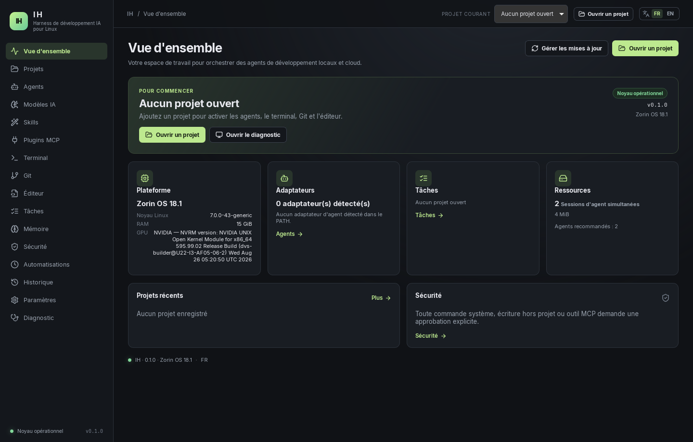
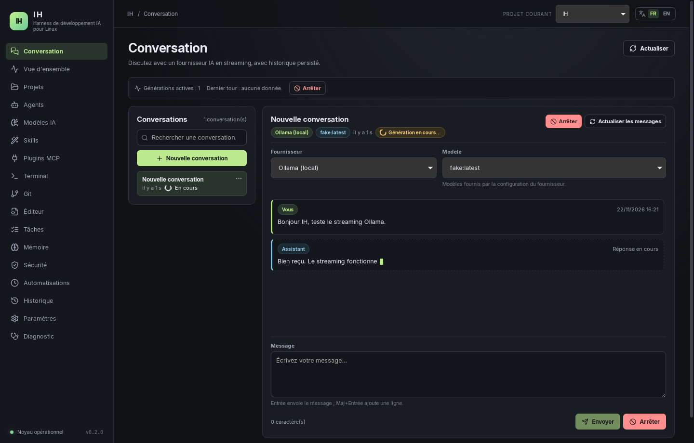
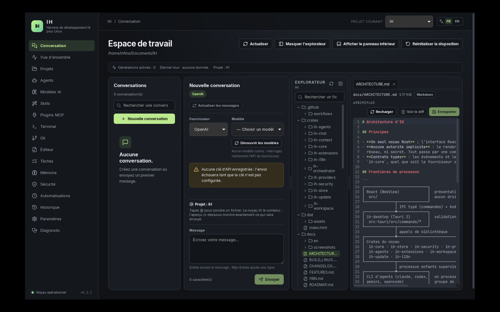
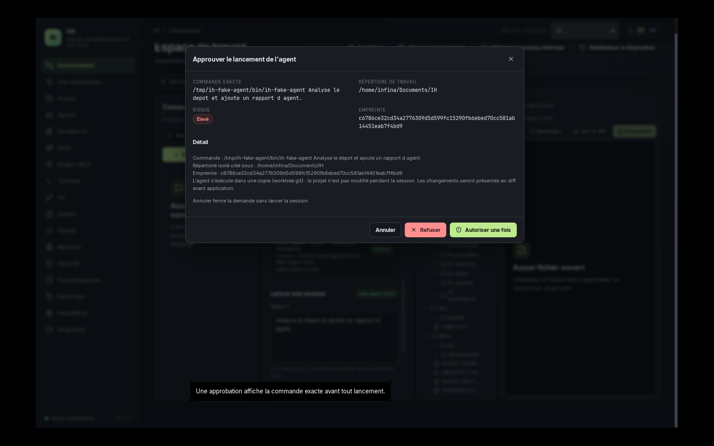

# IH — AI development harness for Linux

IH is a desktop application that orchestrates coding agents (Claude Code, Codex,
Gemini CLI, OpenCode…), cloud and local AI providers, MCP servers, Git, a
terminal and a multi-agent task orchestrator — in one window, on Zorin OS,
Ubuntu/Debian and Arch Linux.

> **Honest status.** This repository is not a mock-up: the Rust core is real and
> tested (208 tests) and all 16 UI sections call real commands. It is not
> finished either — the exact list of what works, what is partial and what is
> missing lives in **[docs/en/FEATURES.md](docs/en/FEATURES.md)**. Read it before
> evaluating IH.









## What IH does

| Area | Status |
|---|---|
| CLI agent supervision (launch, live output, cancel, timeout, concurrency limit) | ✅ |
| AI providers: OpenAI-compatible, Anthropic, Google, Ollama (models, health, streaming) | ✅ |
| **AI conversation**: live streaming, cancellation, history, provider/model selection | ✅ |
| **Workspace**: explorer, tabs, CodeMirror editor, resizable persisted panels | ✅ |
| **Project context**: `@` mentions, Rust-side assembly, secret exclusions | ✅ |
| **Diff**: preview, accept/reject, backup and conflict detection | ✅ |
| **Agent mode**: detected CLI, one-shot approval, worktree isolation, events, diffs | ✅ (controlled agent) |
| **Custom providers**: OpenAI/Anthropic/Google/Ollama-compatible endpoints, headers, connection test | ✅ |
| Model manager (discovery, default model, enable/disable) | ✅ |
| Projects, confined file editing, search | ✅ |
| Git: status, diff, stage, commit, branches, log, worktrees | ✅ |
| Built-in Linux terminal (real PTY) | ✅ (no full VT emulation) |
| Skills: manifest, install, SHA-256 digest, verification | ✅ |
| MCP: stdio servers, tools, approval-gated calls | ✅ (stdio only) |
| Tasks, teams, dependency graph, scheduler | ✅ |
| Per-project persistent memory + bounded prompt injection | ✅ |
| Approvals, risk classification, keyring secrets | ✅ |
| Scheduled automations | ⚠️ manual execution only |
| Conversation history and export | ✅ |
| FR/EN interface (800 keys, parity enforced) | ✅ |
| Logging, diagnostics, exportable report | ✅ |
| Signed updates (Ed25519 + SHA-256) | ✅ (AppImage rollback) |
| DEB, AppImage, Arch package | ✅ (CI build) |

## Install

### Debian / Ubuntu / Zorin OS

```bash
sudo apt install ./IH_0.1.0_amd64.deb
```

### Arch Linux

```bash
cd installers/arch && makepkg -si
```

### AppImage

```bash
chmod +x IH_0.1.0_amd64.AppImage && ./IH_0.1.0_amd64.AppImage
```

Build details: [docs/BUILD_LINUX.md](docs/BUILD_LINUX.md).

## First run

1. **Projects** → “Open a project”: pick your repository folder. IH only writes
   inside that folder.
2. **AI models** → enter a cloud provider API key, or check that Ollama answers
   on `http://127.0.0.1:11434`, then “Discover models”.
3. **Agents** → the list shows which CLIs are actually present in your `PATH`.
   Install one if the list is empty.
4. **Agents** → pick an agent, write an instruction, start it: output streams
   live. **Cancel** kills the whole process group.
5. **Tasks** → “Create a plan” structures a goal into analysis, bounded parallel
   execution and review.

## Security in one sentence

Every shell command, out-of-scope write, installation or MCP tool call requires
an **explicit one-shot approval**; API keys only ever live in the system
keyring. Details: [docs/SECURITY.md](docs/SECURITY.md).

## Updates

IH verifies an **Ed25519-signed** manifest and the artifact **SHA-256** before
any installation, which always requires your confirmation. Publishing tools:
`scripts/gen-update-key.sh`, `scripts/sign-release.sh`, `ih-update-verify`.
Details: [docs/UPDATES.md](docs/UPDATES.md).

## Architecture

Rust workspace with 10 crates (`ih-core`, `ih-store`, `ih-security`,
`ih-providers`, `ih-agents`, `ih-extensions`, `ih-workspace`,
`ih-orchestrator`, `ih-update`, `ih-i18n`) + `src-tauri` + React/TypeScript.
See [docs/ARCHITECTURE.md](docs/ARCHITECTURE.md).

## Development

```bash
npm ci
npm run tauri:dev
```

Checks run locally and in CI:

```bash
cargo fmt --all -- --check
cargo clippy --workspace --all-targets -- -D warnings
cargo test --workspace        # 270 tests
npm run typecheck
npm test                      # 122 tests
npm run build
```

## Documentation

| Document | Content |
|---|---|
| [docs/en/FEATURES.md](docs/en/FEATURES.md) | exact feature status (done / partial / missing) |
| [docs/ARCHITECTURE.md](docs/ARCHITECTURE.md) | boundaries, crates, flows, resource policy |
| [docs/SECURITY.md](docs/SECURITY.md) | implemented controls and accepted limits |
| [docs/UPDATES.md](docs/UPDATES.md) | signing, manifest, install, rollback |
| [docs/en/WORKSPACE.md](docs/en/WORKSPACE.md) | workspace, context and diff guide |
| [docs/AGENT_MODE.md](docs/AGENT_MODE.md) | agent mode guide, adapters and limits |
| [docs/BUILD_LINUX.md](docs/BUILD_LINUX.md) | per-distribution build and packaging |
| [docs/I18N.md](docs/I18N.md) | FR/EN catalogs and parity |
| [README.md](README.md) | documentation française |

## License

IH is distributed under the **MIT** license — see the [LICENSE](LICENSE) file.
Third-party dependencies keep their own licenses.
