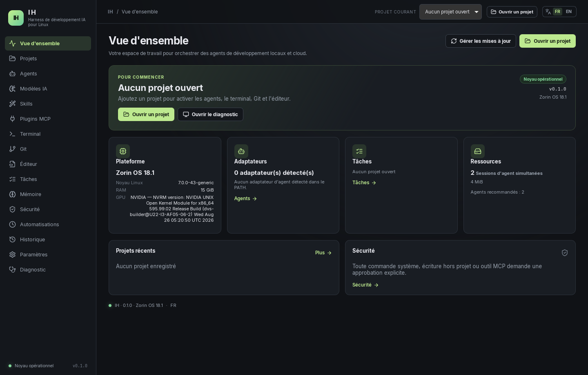
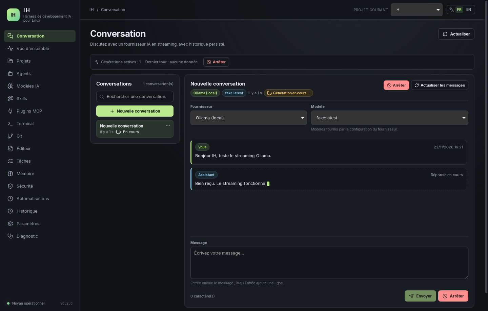
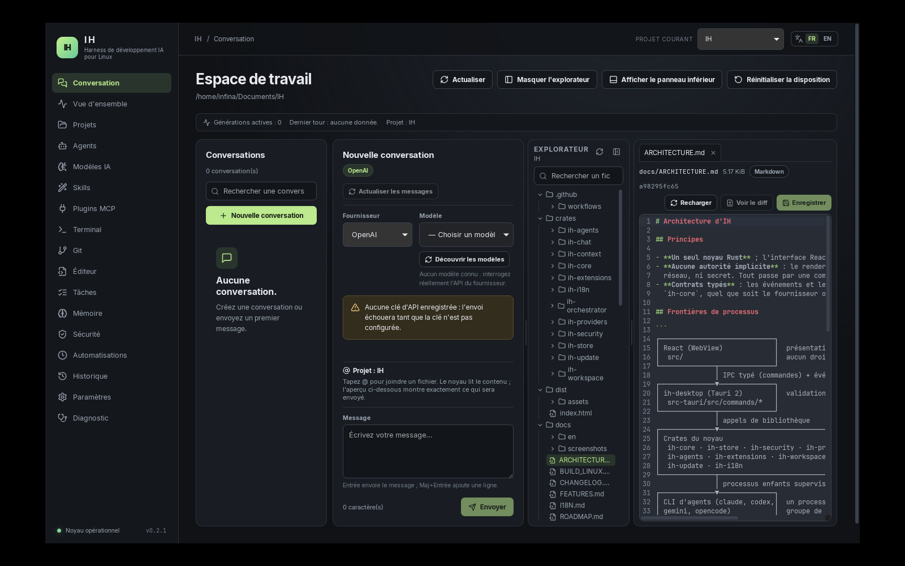
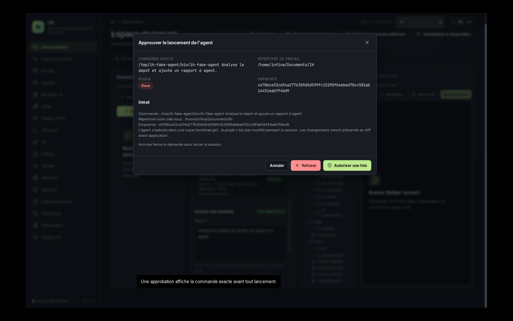

# IH — Harness de développement IA pour Linux

IH est une application de bureau qui orchestre des agents de développement
(Claude Code, Codex, Gemini CLI, OpenCode…), des fournisseurs IA cloud et
locaux, des serveurs MCP, Git, un terminal et un orchestrateur de tâches
multi-agents — dans une seule fenêtre, sur Zorin OS, Ubuntu/Debian et Arch
Linux.

> **Honnêteté sur l'état du projet.** Ce dépôt n'est pas une maquette : le
> noyau Rust est réel, testé (208 tests) et les 16 sections de l'interface
> appellent de vraies commandes. Pour autant, tout n'est pas terminé — la liste
> exacte de ce qui fonctionne, de ce qui est partiel et de ce qui manque est
> dans **[docs/FEATURES.md](docs/FEATURES.md)**. Lisez-la avant d'évaluer IH.









## Ce que fait IH

| Domaine | État |
|---|---|
| Supervision d'agents CLI (démarrage, flux temps réel, annulation, timeout, limite de parallélisme) | ✅ |
| Fournisseurs IA : OpenAI-compatible, Anthropic, Google, Ollama (modèles, santé, streaming) | ✅ |
| **Conversation IA** : streaming temps réel, annulation, historique, sélection provider/modèle | ✅ |
| **Workspace** : explorateur, onglets, éditeur CodeMirror, panneaux redimensionnables persistés | ✅ |
| **Contexte projet** : mentions `@`, assemblage Rust, exclusions des secrets | ✅ |
| **Diff** : aperçu, acceptation/rejet, sauvegarde et détection de conflit | ✅ |
| **Mode Agent** : CLI détecté, approbation ponctuelle, isolation par worktree, événements, diffs | ✅ (agent contrôlé) |
| **Fournisseurs personnalisés** : endpoints compatibles OpenAI/Anthropic/Google/Ollama, en-têtes, test de connexion | ✅ |
| Gestionnaire de modèles (découverte, modèle par défaut, activation) | ✅ |
| Projets, édition de fichiers confinée, recherche | ✅ |
| Git : statut, diff, index, commit, branches, log, worktrees | ✅ |
| Terminal Linux intégré (PTY réel) | ✅ (pas d'émulation VT complète) |
| Skills : manifeste, installation, empreinte SHA-256, vérification | ✅ |
| MCP : serveurs distants natifs (Streamable HTTP + SSE), catalogue d'outils, appels soumis à approbation liée aux paramètres | ✅ (ressources/prompts non couverts) |
| Tâches, équipes, graphe de dépendances, ordonnanceur | ✅ |
| Mémoire persistante par projet + injection bornée dans les prompts | ✅ |
| Approbations, classification du risque, secrets dans le trousseau | ✅ |
| Automatisations planifiées | ⚠️ exécution manuelle seulement |
| Historique des conversations et export | ✅ |
| Interface FR/EN (800 clés, parité vérifiée) | ✅ |
| Journalisation, diagnostic, rapport exportable | ✅ |
| Mises à jour signées Ed25519 + SHA-256 | ✅ (rollback AppImage) |
| DEB, AppImage, paquet Arch | ✅ (build CI) |

## Installation

### Debian / Ubuntu / Zorin OS

```bash
sudo apt install ./ih_0.1.0_amd64.deb
```

### Arch Linux

```bash
cd installers/arch && makepkg -si
```

### AppImage

```bash
chmod +x IH_0.1.0_amd64.AppImage && ./IH_0.1.0_amd64.AppImage
```

Détails de compilation : [docs/BUILD_LINUX.md](docs/BUILD_LINUX.md).

## Premier lancement

1. **Projets** → « Ouvrir un projet » : choisissez le dossier de votre dépôt.
   IH n'écrit que dans ce dossier.
2. **Modèles IA** → saisissez votre clé d'API pour un fournisseur cloud, ou
   vérifiez qu'Ollama répond sur `http://127.0.0.1:11434`, puis
   « Découvrir les modèles ».
3. **Agents** → la liste indique quels CLI sont réellement présents dans votre
   `PATH`. Installez-en un (`npm i -g @anthropic-ai/claude-code`, `codex`,
   `@google/gemini-cli`, `opencode`) si la liste est vide.
4. **Agents** → choisissez un agent, écrivez une instruction, démarrez : la
   sortie s'affiche en flux. **Annuler** tue le groupe de processus.
5. **Tâches** → « Créer un plan » structure un objectif en analyse, exécutions
   parallèles bornées et relecture.

## Sécurité en une phrase

Toute commande shell, écriture hors périmètre, installation ou appel d'outil MCP
exige une **approbation explicite à usage unique** ; les clés d'API ne vivent
que dans le trousseau du système. Détails : [docs/SECURITY.md](docs/SECURITY.md).

## Mises à jour

IH vérifie un manifeste **signé Ed25519** et vérifie le **SHA-256** de
l'artefact avant toute installation, qui reste soumise à votre confirmation.
Outils de publication : `scripts/gen-update-key.sh`, `scripts/sign-release.sh`,
`ih-update-verify`. Détails : [docs/UPDATES.md](docs/UPDATES.md).

## Architecture

Workspace Rust de 10 crates (`ih-core`, `ih-store`, `ih-security`,
`ih-providers`, `ih-agents`, `ih-extensions`, `ih-workspace`,
`ih-orchestrator`, `ih-update`, `ih-i18n`) + `src-tauri` + React/TypeScript.
Voir [docs/ARCHITECTURE.md](docs/ARCHITECTURE.md).

## Développement

```bash
npm ci
npm run tauri:dev
```

Vérifications exécutées en CI et localement :

```bash
cargo fmt --all -- --check
cargo clippy --workspace --all-targets -- -D warnings
cargo test --workspace        # 360 tests
npm run typecheck
npm test                      # 181 tests
npm run build
```

## Documentation

| Document | Contenu |
|---|---|
| [docs/FEATURES.md](docs/FEATURES.md) | état exact des fonctionnalités (fait / partiel / absent) |
| [docs/ARCHITECTURE.md](docs/ARCHITECTURE.md) | frontières, crates, flux, politique de ressources |
| [docs/SECURITY.md](docs/SECURITY.md) | contrôles implémentés et limites assumées |
| [docs/UPDATES.md](docs/UPDATES.md) | signature, manifeste, installation, rollback |
| [docs/WORKSPACE.md](docs/WORKSPACE.md) | guide du workspace, du contexte et du diff |
| [docs/AGENT_MODE.md](docs/AGENT_MODE.md) | guide du mode Agent, adaptateurs et limites |
| [docs/MCP.md](docs/MCP.md) | intégration MCP : transports, sécurité, permissions, intégrations, limites |
| [docs/BUILD_LINUX.md](docs/BUILD_LINUX.md) | compilation et paquets par distribution |
| [docs/I18N.md](docs/I18N.md) | catalogues FR/EN et parité |
| [README.en.md](README.en.md) | English documentation |

## Licence

IH est distribué sous licence **MIT** — voir le fichier [LICENSE](LICENSE).
Les dépendances tierces conservent leurs licences respectives.

